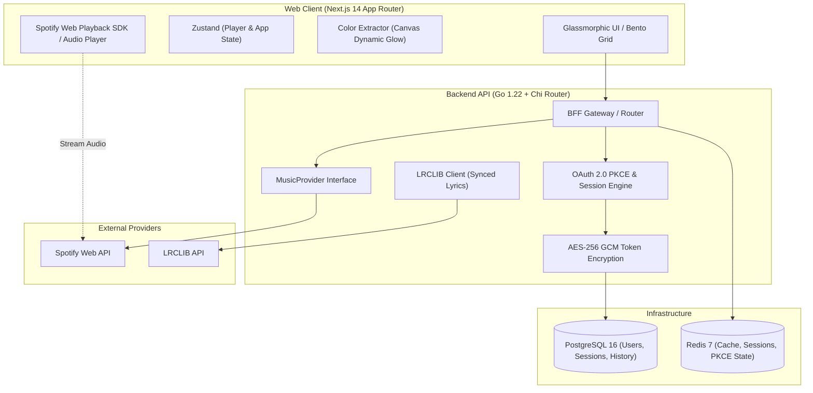

# Sonara — Modern Music Streaming Platform

> Combining the deep catalog of Spotify with Apple Music’s breathtaking aesthetics, dynamic album-reactive ambient glassmorphism, and instant time-synced lyrics.

---

## 🎧 Architecture Overview

Sonara is engineered as a production-quality monorepo using a **Backend-For-Frontend (BFF)** pattern. The browser client **never** holds client secrets or raw refresh tokens. All OAuth 2.0 PKCE handshakes and token refreshes occur securely on the server with AES-256 GCM encrypted persistence.



---

## 🚀 Key Features

1. **Home Bento-Grid Dashboard**:
   - Dynamic *Jump Back In* cards with instant play preview
   - *Listening Pulse* tracking weekly hours and completion streaks
   - *Top Artist Spotlight* and *Curated Soundscapes*
2. **Dynamic Album Reactive Glow**:
   - Custom canvas-based client-side color extraction samples artwork to tint backdrops, player accents, and visualizer bars in real time.
3. **Lossless Player Engine**:
   - Persistent glass bottom player with interactive scrubber, volume slider, shuffle/repeat cycling, and device selector.
   - Expandable full-screen Now Playing modal with ambient reactive gradients.
4. **Time-Synced Lyrics**:
   - Integrated with **LRCLIB** to parse LRC timestamps down to millisecond accuracy with line-by-line vocal tracking.
5. **Three-Pane Desktop & Adaptive Mobile Layout**:
   - Collapsible navigation sidebar, main content view, and contextual right panel with tabs for **Queue**, **Lyrics**, and **Artist Bio**.
   - Mobile-optimized bottom tab bar and swipe-friendly sheet drawer.
6. **Command Palette (`Cmd/Ctrl + K`)**:
   - Keyboard-navigable quick jump for tracks, playlists, mood modes, and settings.
7. **Listening Analytics**:
   - Responsive Recharts visualizations for listening hours, streak counters, and genre affinity curves across 4 weeks, 6 months, and all time.
8. **Mood Switcher**:
   - Instant tone shifting between **Default**, **Focus** (emerald), **Workout** (orange), and **Late Night** (deep indigo).

---

## 🎯 Personalised, API-driven dashboard

Nothing on the home screen is hardcoded. `GET /api/v1/dashboard` builds a list of sections per user from **Spotify**:

- **Your listening**: recently played, top artists and top tracks.
- **Your taste, in any language**: genres are ranked from your top artists (Spotify tags `bollywood`, `punjabi pop`, `k-pop`, `latin pop`, …) and turned into "Because you listen to …" shelves, plus a blended "Made around your taste" shelf.
- **What you told us**: new accounts (or accounts without history) pick languages, genres, artists and a region on `/onboarding`; these are stored per user in Postgres and used alongside real listening data.
- **New releases**: Spotify removed `/browse/new-releases` for Development Mode apps, so this uses the `tag:new` search filter.

Each section is cached (Redis, in-memory fallback) and independent: if Spotify refuses one (403/404/429) that section is simply omitted. The frontend renders sections by `type`/`kind`, so adding a section in `apps/api/internal/dashboard` needs no UI change.

## 🔒 Spotify 2026 API restrictions (Development Mode)

Verified against Spotify's *February 2026 Dev Mode migration guide*:

- App owner needs Premium; max **5** authorised users until you get Extended Quota.
- Search `limit` is capped at **10**.
- Removed: `/browse/new-releases`, `/browse/categories`, `/artists/{id}/top-tracks`, batch `GET /tracks|artists|albums`, recommendations, audio features.
- `GET /me` no longer returns `country`, `product` or `email` (the user's region is chosen in onboarding; Premium is detected by the Web Playback SDK).
- Artist/track `popularity` and artist `followers` are gone; playlist contents are only returned for playlists you own/collaborate on.
- **Full songs** play only for Premium users through the Web Playback SDK; everyone else gets real 30s previews (resolved by track name via iTunes, since Spotify no longer returns `preview_url`).

Upstream failures are typed (`401/403/404/429`) and surfaced to the UI instead of silently falling back to fake data.

> **Run the app at `http://127.0.0.1:3000`** (not `localhost`). Spotify requires the `127.0.0.1` loopback redirect, and the session cookie is only shared when the app and API use the same host.

---

## 🛠 Tech Stack

- **Frontend**: Next.js 14 (App Router), TypeScript (strict), Tailwind CSS, Framer Motion, TanStack Query, Zustand, Recharts, Lucide Icons.
- **Backend**: Go 1.22+, Chi Router, `pgx/v5` (PostgreSQL), `go-redis/v9`, Zerolog, crypto/aes GCM encryption.
- **Data & Cache**: PostgreSQL 16, Redis 7 Alpine.
- **Testing**: Go table-driven unit tests, Playwright end-to-end smoke tests.
- **Infra**: Docker Compose, multi-stage Alpine Dockerfiles, GitHub Actions CI.

---

## 📦 Project Structure

```
sonara/
├── apps/
│   ├── web/                    # Next.js 14 Frontend
│   │   ├── src/
│   │   │   ├── app/            # App Router pages (Home, Search, Library, Stats, Settings, Login)
│   │   │   ├── components/     # Layout, Player, RightPanel, CommandPalette, Toasts
│   │   │   ├── store/          # Zustand stores (usePlayerStore, useAppStore)
│   │   │   ├── lib/            # Color extractor, utils, API client
│   │   │   └── data/           # Seed catalog & fallback fixtures
│   │   └── tests/              # Playwright smoke test suite
│   └── api/                    # Go 1.22 Backend API
│       ├── cmd/server/         # Main entrypoint
│       └── internal/
│           ├── config/         # Environment configuration
│           ├── crypto/         # AES-256 GCM token encryption
│           ├── handler/        # HTTP Chi handlers (Auth, Music, Lyrics, Stats)
│           ├── models/         # Domain models aligned with OpenAPI
│           ├── provider/       # MusicProvider (Spotify, Audius, Jamendo, LRCLIB)
│           ├── repository/     # PostgreSQL pgx queries
│           └── service/        # PKCE logic and token auto-refresh
├── packages/
│   └── api-spec/               # OpenAPI 3.1 specification & TS generator
├── infra/
│   ├── docker-compose.yml      # Orchestration for web, api, postgres, redis
│   ├── Dockerfile.web          # Multi-stage Node Alpine build
│   ├── Dockerfile.api          # Multi-stage Go Alpine build
│   └── postgres/init.sql       # Database schema initialization
├── .github/workflows/ci.yml    # CI pipeline for linting, testing, and building
├── Makefile                    # Developer workflow automation
└── .env.example                # Canonical environment variables template
```

---

## ⚡ Quickstart

### Option 1: Run with Docker Compose (Recommended)

1. Clone and copy environment configuration:
   ```bash
   cp .env.example .env
   ```
2. Start the full stack:
   ```bash
   make docker-up
   ```
3. Open your browser:
   - Web App: [http://127.0.0.1:3000](http://127.0.0.1:3000)
   - API Healthcheck: [http://127.0.0.1:8080/healthz](http://127.0.0.1:8080/healthz)

---

### Option 2: Run Locally for Development

1. **Install dependencies**:
   ```bash
   npm install
   ```
2. **Start Postgres and Redis** (via Docker or local services):
   ```bash
   docker compose -f infra/docker-compose.yml up -d postgres redis
   ```
3. **Run API Server**:
   ```bash
   make dev-api
   ```
4. **Run Web Frontend**:
   ```bash
   make dev-web
   ```

---

## 🧪 Testing

### Go Table-Driven Tests
```bash
make test
# Or navigate to apps/api:
cd apps/api && go test -v ./...
```

### Playwright Smoke Tests
```bash
cd apps/web && npx playwright test
```

---

## 📄 License
MIT © Sonara Engineering
